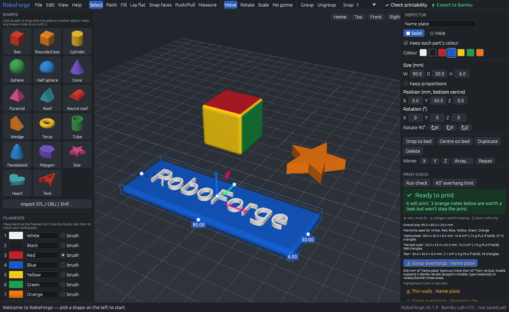

# RoboForge

A Tinkercad-style 3D designer written in Rust, built for multi-colour printing on the
**Bambu Lab H2C**. It runs on Windows and macOS (and Linux). Design with simple shapes and
holes, colour them or paint them face by face, check the model for print problems, and
export a Bambu Studio project that opens with its colours and filaments already set.



## Download

The version number is in the title bar, the status bar, and the download names; see CHANGELOG.md for what changed.

Every push to `main` builds the apps in **GitHub Actions** (Actions tab → latest run →
Artifacts). Tagging a version (for example `v0.1.0`) also attaches them to a Release.

| Platform | File | Notes |
|---|---|---|
| Windows 10/11 (x64) | `RoboForge-<version>-windows-x64.zip` | Unzip and run `RoboForge.exe`. SmartScreen may warn because the app isn't signed: click **More info → Run anyway**. |
| macOS 11+ (Apple Silicon and Intel) | `RoboForge-<version>-macos-universal.zip` | Unzip and drag `RoboForge.app` to Applications. It's ad-hoc signed, so the first time you open it, **right-click → Open**. If macOS still refuses, run `xattr -dr com.apple.quarantine /Applications/RoboForge.app` once in Terminal. |

To build it yourself, install Rust (1.96 or newer) from <https://rustup.rs> and run:

```
cargo run --release
```

## What it does

### Modeling (like Tinkercad)
- **Shape library:** box, rounded box, cylinder (optional bevel), sphere, half sphere,
  cone (with a top-size setting for a truncated cone), pyramid (any number of sides), roof,
  round roof, wedge, torus, tube (wall thickness), paraboloid, polygon, star, heart, and
  **3D text** (two built-in fonts, multi-line, letter spacing).
- **Solid / Hole:** any shape can be a hole. **Group** combines the selected shapes, and
  holes cut away what they overlap. Booleans use a robust Manifold-style engine, so the
  results stay watertight. Groups can be ungrouped, nested, scaled, and rotated.
- **Multi-colour groups:** a group keeps each part's colour by default. Turn off
  *Keep each part's colour* to give the whole group one colour, as Tinkercad does.
- **Snapping:** dragged parts ride up onto other parts and snap edge-to-edge or centre-to-centre with them (pink guide lines); **Snap faces** joins two parts face to face; drag shapes from the panel onto the plate or onto another part. Hold Shift to move freely.
- **Side handles and Push/Pull:** drag a side handle to stretch one side only; the Push/Pull tool extrudes or cuts any flat face by an exact distance.
- **Transforms:** drag objects on the plate with grid snapping. The on-screen gizmo moves,
  rotates (in 15° steps), and scales. Exact size, position, and rotation are in the
  inspector, with *Keep proportions* and quick ±90° rotate buttons.
- Align (min/centre/max on X, Y, Z), mirror, duplicate (or Alt-drag a copy), copy/paste,
  **pattern/array** (straight line or circular), **arrange all on the plate**,
  **drop to bed**, **centre on bed**, and **lay flat on a face**.
- **Measure tool**, dimension labels on the selection, outliner with show/hide and lock,
  undo/redo, and orthographic or perspective view with preset views.
- **Import STL, OBJ (with MTL colours), and 3MF** (including colours from Bambu,
  PrusaSlicer, and Orca 3MFs), plus **Repair** for broken meshes (closes holes, fixes
  flipped faces, removes duplicate faces).
- Projects save as `.pforge` files.

### Parts library
34 ready-made parts in three groups, all resizable (W/D/H or the side handles) with their
own settings in the Inspector:
- **Hardware:** gear, gear rack, bolt, nut, washer, standoff, print-in-place hinge, living hinge,
  snap hook, sliding dovetail, pulley, wheel, spring.
- **Mounting:** bracket, corner brace, wall hook, pegboard hook, pipe clamp, cable clip, cable comb,
  keyhole plate, desk grommet.
- **Home & storage:** box + lid, divided bin, screw-top jar + cap, planter + saucer, funnel, knob,
  drawer handle, phone stand, key tag.

### Pictures and logos
- **Picture to 3D:** lithophanes, raised reliefs and multi-colour photo plates from PNG/JPG.
- **Sketch tool:** draw an outline on a grid, then extrude it up or spin it into a vase, knob or ring.
- **Picture onto a part:** paint a photo or logo onto any part's surface in filament colours.
- **Logo from SVG:** multi-colour logos, one filament per SVG colour.

### Helpers
- **Make it printable** (best face down, onto the plate, spread out, checked), **Overhangs** view,
  drag-and-drop files, **Open recent**, auto-save with crash recovery.

### Colour
- Up to **24 filaments**, matching the H2C's AMS limit. Set each filament's colour to match
  your spools.
- **Colour by height** stripes, and give every object a filament, or **paint** it: a round brush with adjustable radius (the surface refines itself under the brush), a
  **bucket fill** that stops at sharp edges (angle limit), and an eraser.
  **Refine for painting** subdivides a model so the brush can paint fine detail.

### Export
- **Export to Bambu (H2C)** writes a native Bambu Studio project: the *Bambu Lab H2C
  0.4 nozzle* printer, the *0.20mm Standard @BBL H2C* process, one *Bambu PLA Basic*
  filament per colour you used (with your colours), each object's filament, and painted
  faces saved in Bambu's own paint format. Open it and press **Slice**; there's no colour
  mapping dialog. Objects keep their positions on the plate.
- **3MF with colours** (standard 3MF Materials) for PrusaSlicer, OrcaSlicer, Cura, and
  others. **STL** (no colour). **OBJ + MTL** (with colour).

### Print check (runs automatically before every export)
Errors stop the export unless you choose *Export anyway*. Click any issue to see which
faces it affects, highlighted in pink.

| Check | What it catches |
|---|---|
| Watertight / manifold | open edges, edges shared by 3+ faces, inconsistent face winding, inside-out meshes |
| Degenerate / duplicate faces | zero-area and repeated triangles |
| Self-intersection | the surface passing through itself |
| Wall thickness | ray-cast thickness below the nozzle width (missing walls) or below 2× nozzle (fragile walls) |
| Minimum size | features too small for a 0.4 mm nozzle, objects thinner than one layer, likely unit mistakes (inches/metres) |
| Overhangs | faces steeper than your limit (45° by default), flat downward faces (bridges) |
| Unsupported starts | points where printing would begin in mid-air |
| Floating parts | pieces not connected to anything below them; objects hovering above or sunk below the plate |
| Bed adhesion | no flat base, small contact area, tall/narrow parts likely to wobble |
| Build volume | H2C limits: 305 × 320 mm single-colour, 300 × 320 mm multi-colour (dual nozzle), 325 mm height |
| Colours | more filaments than the H2C's 7 hotends (purge swaps) or its 24-filament AMS limit, and colour specks under 1 mm² |
| Scene | separate objects overlapping without being grouped, holes that aren't grouped (they do nothing), hidden objects, failed booleans, sealed internal cavities, very heavy meshes |

It also reports size, volume, estimated PLA weight, triangle count, and which filaments are used.

## Controls

Ctrl on Windows = Cmd on Mac.

- **Mouse:** left-drag an object to move it · left-drag empty space or right-drag to
  orbit · middle-drag or Shift+right-drag to pan · scroll or pinch to zoom ·
  Shift+drag on empty space to box-select · Alt+drag to drag out a copy.
- **Ctrl/Cmd:** Z undo · Shift+Z or Y redo · C / V copy, paste · D duplicate · G group ·
  Shift+G ungroup · A select all · S save.
- **Keys:** H hole · S solid · D drop to bed · F fit view · P paint · B fill ·
  1 / 2 / 3 move / rotate / scale gizmo · arrows nudge (Shift ×10, Ctrl/Cmd+↑↓ raise or
  lower) · Delete · Esc.

## Command line

```
roboforge check model.3mf            # printability report; exit code 1 if errors
roboforge export design.pforge out.3mf   # Bambu H2C project (add --generic for standard 3MF)
roboforge export design.pforge out.stl
roboforge demo sample.pforge         # sample multi-colour project
```

## Not included (compared to Tinkercad)
Codeblocks, Circuits, the community shape gallery, the sketch/scribble tool, SVG import,
and placing a workplane on a slanted face. 

## How the Bambu project is built
`assets/bambu_h2c_template.json` is generated by `tools/gen_bambu_template.py` from
Bambu Studio's own H2C system presets (printer, process, PLA Basic) and the layout of a
real dual-nozzle Bambu project file. If Bambu updates its presets, run the script again
against a newer Bambu Studio checkout.

## License
MIT. Uses egui/eframe, boolmesh, transform-gizmo, and the Ubuntu and Hack fonts
(their own licences apply).
